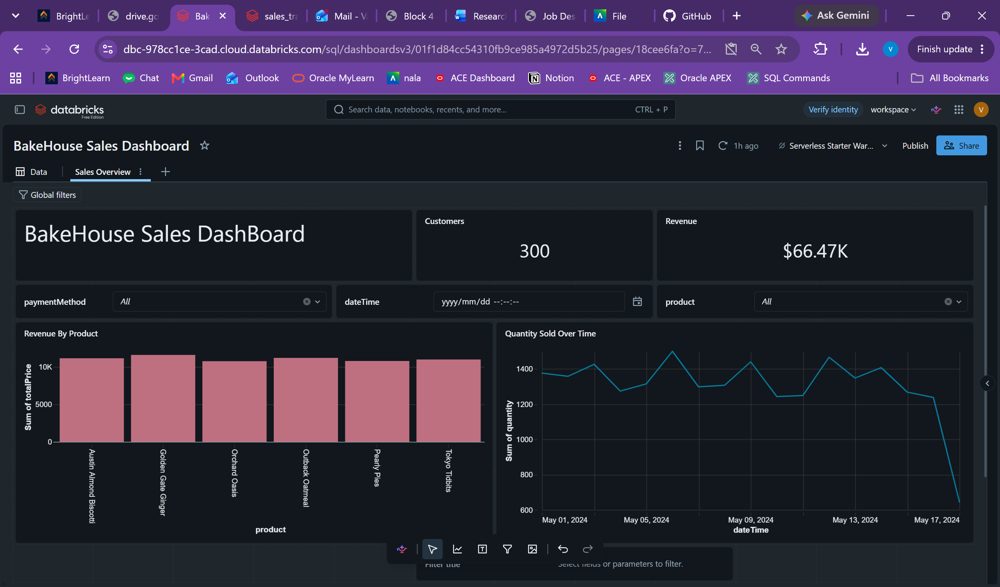

# bakehouse-sales-dashboard
A databricks dashboard for exploring BakeHouse sales,revenue,cstomers and product performance.
# BakeHouse Sales Dashboard

## Overview

An interactive dashboard built in Databricks to explore BakeHouse
sales performance.

The dashboard includes revenue and customer KPI cards, a revenue
comparison by product, and filters for payment method, date/time,
and product.

## Dashboard preview

## Tools used

- Databricks AI/BI Dashboards
- Databricks dashboard dataset queries
- GitHub for project documentation and version history

## Data source

Replace this line with the dataset or Databricks table used.

## Project files

- The `.lvdash.json` file contains the exported dashboard definition.
- `dashboard-preview.png` provides a visual preview.

## Exploring the project

View the screenshot above for a preview.

To explore the dashboard interactively, download the `.lvdash.json`
file and import it into a Databricks workspace with access to the
required data sources.
